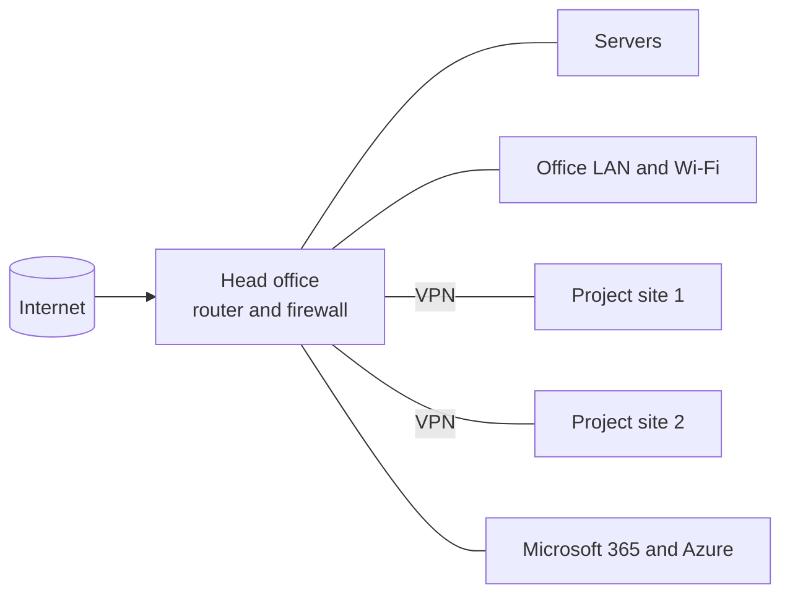

# 01 - Environment overview

| | |
|---|---|
| Organisation | Example Co. Ltd |
| Document owner | IT lead |
| Last reviewed | YYYY-MM-DD |

## Summary

Two or three sentences: what the company does, how many users and sites, and the main platforms (for example Microsoft 365, Azure, MikroTik routers, Windows PCs).

## Sites

| Code | Name | Type | Users | Internet link | Local IT contact |
|---|---|---|---|---|---|
| HO | Head office (example) | Office | 80 | Fiber, ISP-A | IT team |
| PS-01 | Project site 1 (example) | Project site | 15 | Fiber, ISP-B | Site admin |
| PS-02 | Project site 2 (example) | Project site | 10 | Radio, ISP-C | Site admin |

## Systems at a glance

| Area | Main platform | Owner | Document |
|---|---|---|---|
| Network | MikroTik routers, managed switches | IT lead | [02](02-network.md) |
| Servers | Windows Server, Hyper-V | IT lead | [03](03-servers.md) |
| Identity and email | Microsoft 365, Entra ID | IT lead | [04](04-microsoft-365-and-entra.md) |
| Cloud | Azure | IT lead | [05](05-azure.md) |
| PCs | Windows 11 | IT support | [06](06-endpoints.md) |
| Security and backup | Defender, backup tool | IT lead | [07](07-security-and-backup.md) |
| Phones | IP PABX | IT support | [08](08-telephony.md) |

## Overview diagram

Replace this with your real layout.

## Contacts

| Role | Name | Phone | Email |
|---|---|---|---|
| IT lead | | | |
| Backup contact | | | |
| ISP-A support | | | |
| Hardware vendor | | | |
| Microsoft partner | | | |

Where emergency credentials are kept (name the vault and the two people who can open it, not the passwords): ______
