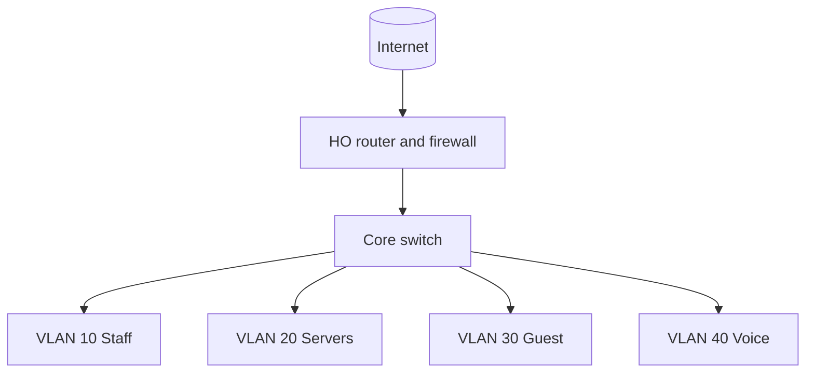

# 02 - Network

Owner: ________  Last reviewed: ________

## Internet links

| Site | ISP | Type | Speed | Circuit ID | Static IP | Support contact |
|---|---|---|---|---|---|---|
| HO | ISP-A | Fiber | 100 Mbps | (example) | No | |
| PS-01 | ISP-B | Fiber | 50 Mbps | (example) | No | |

## IP plan

Keep the full list in [`templates/ip-plan.csv`](../templates/ip-plan.csv). Summary:

| Range | Use |
|---|---|
| 10.10.0.0/16 | All company networks (example) |
| 10.10.<site>.0/24 | One LAN per site |
| 10.10.200.0/24 | VPN tunnels |
| 10.10.250.0/24 | Management of network devices |

Rule for each LAN: `.1` gateway, `.2-.20` network gear, `.21-.99` servers and printers (static), `.100-.239` DHCP, `.240-.254` reserved.

## Network devices

| Name | Site | Role | Model | Firmware | Mgmt IP | Config backup |
|---|---|---|---|---|---|---|
| HO-RTR-01 | HO | Router and firewall | (example) | 7.x | 10.10.250.1 | Weekly export, stored in ______ |
| HO-SW-01 | HO | Core switch | (example) | | 10.10.250.11 | |
| PS01-RTR-01 | PS-01 | Router | (example) | 7.x | 10.10.250.21 | |

## VLANs

| VLAN | Name | Subnet | Purpose |
|---|---|---|---|
| 10 | Staff | 10.10.10.0/24 | Office PCs |
| 20 | Servers | 10.10.20.0/24 | Servers |
| 30 | Guest | 10.10.30.0/24 | Guest Wi-Fi, internet only |
| 40 | Voice | 10.10.40.0/24 | IP phones |

## Core services

| Service | Where it runs | Notes |
|---|---|---|
| DHCP | Router per site | Pool ranges in the IP plan |
| DNS | | Forwarders: |
| NTP | | |
| Internal DNS zone | | |

## Wi-Fi

| SSID | VLAN | Security | Who uses it |
|---|---|---|---|
| Corp (example) | 10 | WPA2/WPA3 Enterprise | Staff |
| Guest (example) | 30 | WPA2/WPA3 Personal, isolated | Visitors |

## VPN and site links

| From | To | Type | Notes |
|---|---|---|---|
| PS-01 | HO | Site-to-site (IPsec or WireGuard) | |
| HO | Azure | Site-to-site VPN | See [05](05-azure.md) |

## Firewall policy summary

What is allowed in, what is allowed out, and what is blocked by design. Link to your router configuration standard if you have one.

## Diagram

## Known issues and risks

| Issue | Impact | Plan |
|---|---|---|
| | | |
