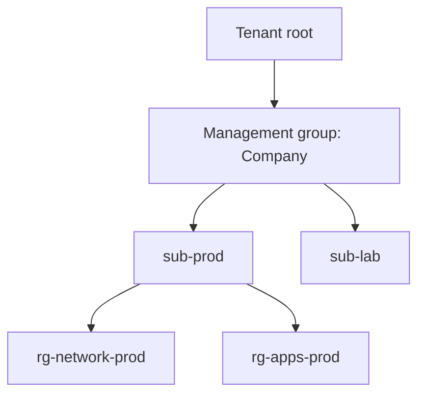

# 05 - Azure

Owner: ________  Last reviewed: ________

## Subscriptions

| Name | Purpose | Owner | Billing | Budget alert |
|---|---|---|---|---|
| sub-prod (example) | Production workloads | IT lead | Monthly | Yes |
| sub-lab (example) | Learning and tests | IT lead | Monthly | Yes, low limit |

## Structure

## Naming and tags

Pattern: `<type>-<workload>-<environment>-<region>`, for example `vnet-core-prod-sea`.

| Tag | Meaning |
|---|---|
| owner | Team or person responsible |
| environment | prod, test, lab |
| costcentre | Who pays |

## Networking

| Item | Value |
|---|---|
| Virtual networks | vnet-core-prod-sea, 10.50.0.0/16 (example) |
| Subnets | |
| VPN gateway | Connects to HO router, see [02](02-network.md) |
| DNS | |
| Network security groups | Default deny inbound, rules documented here |

On-premises and Azure address ranges must never overlap.

## Resources

| Resource | Type | Resource group | Purpose | Backup |
|---|---|---|---|---|
| | | | | |

## Access control

| Group | Role | Scope |
|---|---|---|
| Azure-Admins | Owner | sub-prod |
| Azure-Readers | Reader | Management group |

Use groups, not individual users, for role assignments.

## Security and monitoring

| Item | Value |
|---|---|
| Microsoft Defender for Cloud | On or off, plan |
| Activity log and diagnostics | Sent to ______ |
| Alerts | Who receives them |
| Azure Policy | Policies assigned |

## Cost control

| Item | Value |
|---|---|
| Monthly budget | |
| Alert thresholds | 50, 80, 100 percent |
| Review | Monthly, by ______ |
| Shutdown schedule for non-production VMs | |

## Recovery

How each workload is backed up or rebuilt, and where the infrastructure code lives (Bicep, Terraform or portal-only).
